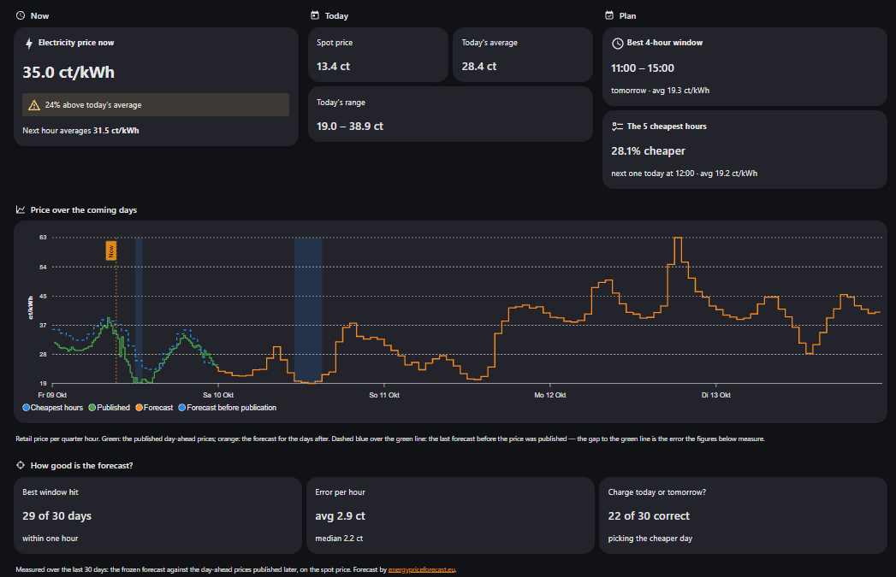

# Energy Price Forecast EU for Home Assistant

[](https://my.home-assistant.io/redirect/hacs_repository/?owner=BackupBaTTerY&repository=energypriceforecast-home-assistant&category=integration)

Home Assistant integration for electricity-price and consumption-based CO2
forecasts from [Energy Price Forecast EU](https://energypriceforecast.eu/),
for 34 price zones across Europe. Installable straight from the HACS default
store.

The integration combines published day-ahead prices with forecast values for
the remaining horizon. It exposes ready-to-use entities for automations without
requiring YAML or JSON templates.

**Questions, ideas, or something you would like it to do?** Ask in
[Discussions](https://github.com/BackupBaTTerY/energypriceforecast-home-assistant/discussions) - that is where wishes are collected and answered.
Something broken? [Report a problem](https://github.com/BackupBaTTerY/energypriceforecast-home-assistant/issues/new?template=bug_report.yml).



*Germany, retail price, a Friday in October 2026. Green is the published
day-ahead price, orange the forecast for the days after, dashed blue the last
forecast before each price was published. The whole view is
[ready to paste](https://github.com/BackupBaTTerY/energypriceforecast-home-assistant/blob/main/docs/dashboard.md#a-card-that-answers-what-to-do-now-1130).*

## Quick start

1. **Install** it with the HACS button above, then restart Home Assistant.
2. **Add it** under **Settings > Devices & services > Add integration**:
   search for **Energy Price Forecast EU** and pick your price zone. No
   account and no API key needed.
3. **Use it.** The quickest wins:
   - switch a heat pump, water heater or charger with a
     [ready-made blueprint](#ready-made-automations-blueprints), no YAML;
   - put **Current price** and the price chart on a dashboard
     ([ready to paste](#build-a-price-chart));
   - let an [AI assistant](#using-it-with-an-ai-assistant) write the
     automation for your device.

Everything else is optional and can be added later: the price you actually
pay, grid charges, your own Nord Pool or ENTSO-e prices.

## Find your way

| You want to | Read |
| --- | --- |
| Know whether this is for you | [Why next to Nord Pool or Tibber](#why-install-this-next-to-nord-pool-or-tibber) · [Supported markets](#supported-markets) · [How good is the forecast](#how-good-is-the-forecast-really) |
| Install and update | [Installation](#installation-with-hacs) · [Updating](#updating) · [Your entity IDs](#finding-your-entity-ids-first) |
| Run devices at the right time | [Which plan should I use?](#which-plan-should-i-use) · [Switching a device](#switching-a-device-with-the-plan) · [Blueprints](#ready-made-automations-blueprints) · [Home batteries](#home-batteries-emhass-and-predbat) |
| See the price you actually pay | [Retail price](#retail-price-estimate-or-your-own-formula-160) · [Grid charges](#time-of-day-grid-charges-170) · [Hourly or quarter-hourly](#hourly-or-quarter-hourly-tariff-1120) · [Your currency](#prices-in-your-own-currency-140) |
| Get official prices sooner | [Your own price source](#your-own-price-source-1210) · [When official prices are missing](#when-the-official-prices-are-missing-1150) |
| Look further ahead | [48 or 120 hours](#horizon-48-hours-free-120-hours-with-private-pro) |
| Chart it | [Build a price chart](#build-a-price-chart) |
| Let an AI help | [Using it with an AI assistant](#using-it-with-an-ai-assistant) |
| Get help | [Support](#support) · [Privacy](#privacy) |

## Why install this next to Nord Pool or Tibber?

Those integrations show prices once they are published: today's, and
tomorrow's from around 13:00 CET. Whether to charge the car today or wait,
or run the heat pump harder tonight, is often decided before that - or
needs a look further ahead than tomorrow. This integration:

- **fills the hours nobody has published yet** with a forecast, kept apart
  from the published prices, so an automation can plan before the auction:
  48 hours ahead for free, up to 120 hours - five days - with
  [Private Pro](#horizon-48-hours-free-120-hours-with-private-pro);
- **turns it into decisions**: cheapest window, cheapest-hours plan, "is now
  a good time", the same for CO2 - ready-made entities, no templates;
- **tells you how good the forecast is in your market**, measured every day
  against the prices that were published afterwards.

It does not replace your existing price integration. Keep it; this one adds
the hours it cannot know yet. Since 1.21.0 it can also
[read your Nord Pool or ENTSO-e prices](#your-own-price-source-1210), so
published hours come from your source and only the rest is a forecast.

**An example from Germany**, rolling 30 days from 9 September to 8 October
2026, taken from the [public forecast quality page](https://energypriceforecast.eu/en/forecast-quality/):

- The forecast's cheapest four-hour window started within one hour of the
  actual cheapest one on **29 of 30 days**. Following it cost on average
  0.13 ct/kWh more than a perfect choice.
- Eight times the forecast said *wait, tomorrow is cheaper*. It was right
  **all eight times**, and tomorrow's window was on average **6.9 ct/kWh**
  cheaper - about 2.80 EUR on a 40 kWh car charge.

With [Private Pro](#horizon-48-hours-free-120-hours-with-private-pro) the
forecast reaches five days, and that has a measured value of its own. Over 29
evenings from 25 September to 23 October 2026, choosing the charging day among
four days instead of two was cheaper **12 times** and more expensive twice -
on average **2.43 ct/kWh** less, about 0.97 EUR per 40 kWh charge.

Quality differs by market. It is strongest where prices swing a lot within
the day, as in Central Europe and Denmark, and weaker in the hydro-dominated
Nordic zones. The quality page lists every market, updated daily, and the
integration shows the figures for yours as entities.

## Features

- UI-based setup through Home Assistant's integration flow
- Current electricity price and current CO2 intensity
- Cheapest price window and greenest CO2 window, with a countdown to the end
  of each
- Binary sensors indicating whether a best window is active now
- Best-window duration in quarter hours *(1.13.0)*: ask for the 3.5 hours a
  charge actually takes
- **Hourly or quarter-hourly tariff** *(1.12.0)*: tell the integration how
  your contract prices time, so every number matches your bill
- **Everything that describes "now" switches at the slot boundary**
  *(1.11.0)*: current price, CO2 intensity, the window countdowns and every
  "active now" flag change on the quarter hour themselves, instead of waiting
  for the next poll
- Combined price/CO2 window: when the best compromise between a low price
  and low emissions is
- **Combined score now** *(1.5.0)*: how the present ranks against the
  published hours ahead, on price and CO2 together - a 0-100 number an
  automation can act on
- **Combined score outlook** *(1.10.0)*: the same ranking for every upcoming
  published slot on one shared scale, for charts and advance planning
- Raw price-series sensor with `raw_today` / `raw_tomorrow` / `raw_forecast`
  attributes (compatible with `apexcharts-card` and custom templates), plus
  Nordpool-style `average` / `min` / `max` / `price_percent_to_average`.
  Published values already seen today remain available across updates and
  restarts, and the current price moves at each exact quarter hour *(1.9.0)*
- **Saved forecast comparison** *(1.12.0)*: the first forecast received for
  each future slot stays visible alongside later official prices, including
  after a restart. Available for both market and retail prices, without an
  additional API call; see the ready-to-paste chart below.
- The same series for **CO2 intensity** *(1.2.0)*, so emissions can be charted
  the way prices already could
- **Forecast quality**: how often the forecast actually picked the cheapest
  window, replayed against the day-ahead prices published afterwards, and what
  missing it cost - measured for your market, not claimed
- **Forecast accuracy** and **cheaper day decision** *(1.8.0)*: by how much
  each single hour was off, and how often "today or tomorrow" pointed at the
  cheaper of the two days
- Optional "cheapest hours" plan - the N cheapest individual hours of each
  fixed, repeating block (e.g. every calendar day, or every 48 hours), which
  may be non-contiguous, unlike the single best continuous window above. Once
  a block's plan is picked it is locked and never reshuffled by a later
  forecast update - the one exception is the day-ahead auction, which may
  correct a plan that was still a guess, once *(1.1.0)*. No plan is published
  at all for a block the forecast does not yet fully cover
- **What the plan is worth**: the average price of its picked hours and how
  far below the block average that lands
- Optional independent weekend plan (Saturday 00:00 to Monday 00:00) for
  loads that are only flexible on weekends, e.g. EV charging
- Optional **"most expensive hours" plan** *(1.14.0)* - the same block and the
  same locking, read from the other end: the hours to keep a load out of, or to
  discharge a home battery into. Off unless you set a count
- Optional "cleanest hours" plan *(1.2.0)* - the same block, the same locking,
  but picked on grid CO2 intensity instead of price
- Optional retail price - our assumption-based estimate for DE, NL, DK, AT
  and NO, or *(1.6.0)* your own formula, day-ahead × factor + surcharge, in
  every market. Plans and savings are then computed on the price you
  actually pay
- Optional time-of-day grid charges *(1.7.0)* - windows and amounts from
  your price sheet, prefilled in Norway, looked up in Denmark - so plans
  pick the hours that are cheapest on the bill, not just on the exchange
- Optional prices in your own currency *(1.4.0)* - Czech koruna, Polish złoty
  or Swedish krona instead of euro, at the ECB's daily reference rate
- Optional **own price source** *(1.21.0)* - day-ahead prices from your Nord
  Pool or ENTSO-e sensor replace the forecast hours they cover: usually
  earlier than ours, and in 18 zones the only way to real prices
- Configurable poll interval (15-120 minutes)
- Access and horizon diagnostics, with API key and postal code redacted
- Multiple market entries, for example DK1 and DK2
- Optional API key support

## Supported markets

AT, BE, BG, CH, CZ, DE, DK1, DK2, ES, FI, FR, GB, GR, NL, NO1-NO5, PL, PT,
RO, SE1-SE4, SK and the seven Italian price zones: ITN, IT_CNOR, IT_CSUD,
IT_SUD, IT_CALA, IT_SICI and IT_SARD.

**Great Britain is new and still finding its feet.** Three things to know
before you plan a load by it:

- **Prices are in pence.** GB is the only market whose prices are published
  in its own currency rather than converted from euro, so the sensors read
  `GBP/kWh` and a retail formula is typed in pence.
- **There is no measured forecast quality yet.** Quality is judged over a
  rolling 30 days and the British forecasts started in October, so the two
  quality sensors stay empty for a while. That is the same warm-up every
  market went through; it is not a fault.
- **There is no retail estimate**, as for Switzerland and the Italian zones.
  The own retail formula works, and time-of-day grid charges can be entered
  by hand.
- **The forecast is hourly, British tariffs are half-hourly.** Agile and its
  kind set a price for every 30 minutes; the day-ahead auction this forecast
  is built on is hourly. For choosing when to run something the difference is
  small - over 30 days of real Agile prices, picking by the hour rather than
  the half hour came out about 0.1 p/kWh worse, some six pence on a 40 kWh
  charge - but the price shown for *now* is an hourly average, so it sits
  between the two half-hourly rates you are billed. The setup dialog says so
  when you pick GB.

**Bulgaria, Greece, Portugal, Romania, Slovakia and Spain joined in 1.8.0**
(September 2026). Prices, plans, CO2 and forecast quality work there as in
every other market, Slovakia and Romania included: the API now delivers
CO2 data for both, so the CO2 entities, the CO2 series, the cleanest-hours
plan and the CO2 half of the combined score are filled there too. How good
the forecast is in each of them is measured like everywhere else, over a
rolling 30 days, on the
[forecast quality page](https://energypriceforecast.eu/en/forecast-quality/).

There is no retail estimate for Switzerland or the Italian zones; they
provide spot price and CO2. The own retail formula *(1.6.0)* can be set up
there like anywhere else, but read the next section before relying on it.

### Before you automate on price in CH or IT

These two markets sell electricity to households differently, and it
changes what a cheap hour is worth to you.

**Switzerland — no exchange-coupled household tariff, as far as we know.**
Around 590 grid operators each set their own tariff, calculated from their
own generation and procurement costs, filed with ElCom by the end of
August for the following year, and fixed for that whole year. Households
cannot switch supplier; full market opening is not expected before 2028.
So a cheap hour on the exchange does not make your bill smaller. The
price entities still show you what the wholesale market is doing, and the
CO2 entities work exactly as everywhere else -- shifting a load to a
clean hour lowers emissions whatever your tariff says. If you know of a
Swiss household tariff that does follow the spot price, please open an
issue; we would like to be wrong about this.

**Italy — coupled, but usually not by the hour.**
Indexed offers on the free market follow the PUN, which *is* the
day-ahead exchange price. Most of them bill the monthly average, or the
three F1/F2/F3 time bands. Hourly-indexed contracts exist, and only on
one of those does shifting a load within the day change your energy rate.

There is a second wrinkle: Italian bills use the *national* PUN, while
this integration reports your *zonal* price. Over 153 days we compared
the zonal series against a load-weighted national index built from all
seven zones. They picked the same cheapest four-hour window on 93% of
days, at an average cost of 0.05 ct/kWh when they disagreed. The timing
carries; the price level does not, which is why there is no retail
estimate for Italy. On an hourly-indexed contract the own formula *(1.6.0)*
gets you close, with one caveat: it scales your zonal price, not the PUN.
In Switzerland it would describe a tariff that, as far as we know, does
not exist.

## Installation with HACS

The integration is listed in the HACS default store, so there is nothing to
add by hand. This button opens it in your own Home Assistant:

[](https://my.home-assistant.io/redirect/hacs_repository/?owner=BackupBaTTerY&repository=energypriceforecast-home-assistant&category=integration)

Or by hand:

1. Open HACS in Home Assistant and search for **Energy Price Forecast EU**.
2. Download it and restart Home Assistant.
3. Open **Settings > Devices & services > Add integration**, search for
   **Energy Price Forecast EU** and pick your market.

Installed from a custom repository before it was listed? Nothing to do: HACS
keeps the entry and goes on offering updates. You may remove the custom
repository entry under the three dots in HACS if you want it tidy.

## Manual installation

1. Copy `custom_components/energypriceforecast` from this repository to
   `/config/custom_components/energypriceforecast` in Home Assistant.
2. Restart Home Assistant.
3. Open **Settings > Devices & services > Add integration** and search for
   **Energy Price Forecast EU**.

An older YAML package using the same API remains fully supported and can run
in parallel - remove it only after the new entities have been checked.

## Updating

Download the update in HACS, then **restart Home Assistant**. Reloading the
integration is not enough: until the restart the old version keeps running,
setup forms included, even though HACS already lists the new one. Your
settings and entities are kept.

## Entities

One device is created per configured market.

### Finding your entity IDs first

**Do not copy entity IDs out of this README - look up your own.** Open
**Settings > Devices & services > Energy Price Forecast EU**, click the device,
and use the entity list there; or filter for `energypriceforecast` under
**Developer tools > States**.

The names in the tables below are the English display names. Your `entity_id`
will usually *not* match them, for two reasons that surprise most people:

- **They follow your Home Assistant language.** On a German instance the
  "Current price" sensor is `sensor..._aktueller_strompreis`, the price
  series is `sensor..._preisreihe`, not `_price_series`, and the current
  retail price is `sensor..._aktueller_endkundenpreis`. Searching for the
  English name finds nothing.
- **They are generated once, when each entity is first created**, and are never
  renamed afterwards. Entities that an update adds later can therefore pick up
  a different prefix than the ones created earlier - for example an area name,
  if the device was moved into an area in the meantime. Mixed prefixes within
  one device are normal and harmless.

If the inconsistency bothers you, rename them: click an entity, then the gear
icon, and edit its entity ID. That is a purely local change and nothing in this
integration depends on the ID.

### Always created

| Name | Type | Unit |
| --- | --- | --- |
| Current price | sensor | market currency, e.g. EUR/kWh |
| Current CO2 intensity | sensor | gCO2/kWh |
| Cheapest window average price | sensor | market currency |
| Cheapest window start | sensor | timestamp |
| Cheapest window end | sensor | timestamp |
| Greenest window average CO2 | sensor | gCO2/kWh |
| Greenest window start | sensor | timestamp |
| Greenest window end | sensor | timestamp |
| Combined score now *(1.5.0)* | sensor | 0-100, higher is better |
| Combined window score (deprecated) | sensor | disabled for new installs, see below |
| Combined window start *(1.2.0)* | sensor | timestamp |
| Combined window end *(1.2.0)* | sensor | timestamp |
| Cheapest window remaining *(1.0.0)* | sensor | minutes |
| Greenest window remaining *(1.0.0)* | sensor | minutes |
| Price forecast series | sensor | market currency |
| CO2 forecast series *(1.2.0)* | sensor | gCO2/kWh |
| Cheapest window active | binary sensor | on/off |
| Greenest window active | binary sensor | on/off |
| Combined window active *(1.2.0)* | binary sensor | on/off |
| Published prices missing *(1.15.0)* | binary sensor | on/off |

Plus eight diagnostic entities, shown separately in the device page:
**Allowed horizon** and **Used horizon** (hours), **API-key status**,
**Price source** (whether the current price is a published `day_ahead` price
or a `forecast`), **Forecast quality** *(1.0.0)*, **Forecast accuracy**
*(1.8.0)* and **Cheaper day decision** *(1.8.0)* - the three measured numbers
are explained below - and **Last API update** (timestamp).

"Cheapest window" here is the single *contiguous* window of the configured
best-window duration - not the same thing as the cheapest-hours plan below.

The duration is set in quarter hours *(1.13.0)*, so a charge that takes three
and a half hours can ask for 3.5 instead of coming up half an hour short at 3
or paying for an unused hour at 4. One caveat worth knowing: the measured
**forecast quality** beside it is published per whole hour, so a 3.5-hour
window is reported with the figures of the 3-hour one.

How the combined window and the combined score are worked out is explained
in [Entity details](https://github.com/BackupBaTTerY/energypriceforecast-home-assistant/blob/main/docs/entities.md#the-combined-window-and-score).

### With retail pricing enabled

| Name | Type | Unit |
| --- | --- | --- |
| Current retail price | sensor | market currency |
| Cheapest window average retail price | sensor | market currency |
| Cheapest window start (retail) | sensor | timestamp |
| Cheapest window end (retail) | sensor | timestamp |
| Cheapest window active (retail) | binary sensor | on/off |

These mirror the base entities but are computed on the all-in retail price -
the estimate or your own formula, see
[Retail price](#retail-price-estimate-or-your-own-formula-160). With the
estimate the cheapest window can differ from the spot-price one; with a
formula it cannot, only its price does.

**Where to find the price you pay.** **Price forecast series** stays the
day-ahead price and its forecast, without grid charges or taxes. Your own
price is in **Current retail price**: its state is the price right now, and
its `raw_today`, `raw_tomorrow` and `raw_forecast` attributes carry the whole
series in the same shape.

### With a cheapest-hours count above 0

| Name | Type | Unit |
| --- | --- | --- |
| Next cheapest hour | sensor | timestamp |
| Cheapest hours average price *(1.0.0)* | sensor | market currency |
| Cheapest hours saving *(1.0.0)* | sensor | % |
| Cheapest hours active | binary sensor | on/off |

### With a weekend-hours count above 0

| Name | Type | Unit |
| --- | --- | --- |
| Next weekend cheapest hour | sensor | timestamp |
| Weekend hours average price *(1.0.0)* | sensor | market currency |
| Weekend hours saving *(1.0.0)* | sensor | % |
| Weekend cheapest hours active | binary sensor | on/off |

These four are **unavailable for most of the week, by design.** The weekend
plan covers the whole Saturday 00:00 - Monday 00:00 block and is only built
once your series reaches the end of it; a plan over the part that happens to
be in view would pick Saturday hours and call them the weekend's cheapest.
So the entities come alive once `now + your horizon` reaches Monday midnight:

| Horizon | Weekend plan appears from |
| --- | --- |
| 48 hours | Saturday 00:00 - during the weekend itself |
| 72 hours | Friday 00:00 |
| 96 hours | Thursday 00:00 |
| 120 hours | Wednesday 00:00 |

On the 48-hour horizon that makes them a weekend-only readout rather than
something to plan with. **Used horizon** among the diagnostic entities says
which one you have.

### With a cleanest-hours count above 0 *(1.2.0)*

| Name | Type | Unit |
| --- | --- | --- |
| Next cleanest hour | sensor | timestamp |
| Cleanest hours average CO2 | sensor | gCO2/kWh |
| Cleanest hours saving | sensor | % |
| Cleanest hours active | binary sensor | on/off |

The CO2 counterpart of the cheapest-hours plan, picked from the **same block**
you configured above - same length, same start hour - but ranked on grid CO2
intensity instead of price. Everything else is identical: the plan locks once
picked, no partial plan is ever published, and the saving compares the picked
hours against the block's own average.

### The hours to stay out of *(1.14.0)*

Set **Most expensive hours per block** and you get the cheapest-hours plan read
backwards: the dearest hours of the same block, picked and locked the same way,
corrected once when the day-ahead prices settle, and never reshuffled after
that. It is meant for the two cases where the cheap hours are not the question -
discharging a home battery, and keeping a dryer or a heat pump out of the peak.

Three entities appear, and only if you set a count above zero:

| Entity | What it is |
|---|---|
| Next expensive hour | When the next planned expensive hour starts, with the whole plan in its `hours` attribute |
| Most expensive hours average price | What those hours average |
| Most expensive hours surcharge | How far above the block's own average they land, in percent |

Plus the binary sensor **Most expensive hours active**, the inverse trigger of
the cheapest-hours one.

The surcharge is measured against the same block average the saving uses, so
the two numbers are comparable: one says what picking the cheap hours gained,
the other what avoiding the dear ones was worth. Both are withheld when the
block average is zero or negative, where a percentage describes nothing.

One limitation worth knowing: nothing stops the cheapest and the most expensive
plan from being configured so tightly that they meet in the middle of a short
block. They are two independent plans over the same hours, not one schedule.

### Price spike possible *(1.18.0)*

In AT, BE, CZ, DE, DK1, DK2, FR and NL there is one more binary sensor,
**Price spike possible** - the same hint the Energy Price Forecast app shows.
It is **disabled by default**; enable it on the device page if you want it.

| Name | Type | Unit |
| --- | --- | --- |
| Price spike possible | binary sensor | on/off |

It is on while the forecast marks an upcoming evening hour (16:00-23:00 local)
as a possible price spike: a regional spike-risk index across these markets -
residual load, scarcity and how little wind and sun there is - has reached
0.99 for that hour. `next_start` and `next_end` give the next marked stretch,
`periods` all of them. Only hours without a published price are marked; once
tomorrow's prices are out, they say for themselves whether the spike came.
The prices in the series are never changed by it. In `raw_forecast` the
marked slots carry `spike_possible: true`, so a chart can colour them.

**How often it is right** - read this before automating on it. Live from 18
October to 13 November 2026, 106 of 192 marked hours were real spikes
(the day-ahead price ended at least 5 ct/kWh above the forecast). That
November had far more evening spikes than usual; over a whole year, about
**one mark in seven** is to be expected. So it suits decisions where a false
alarm costs little - keep the home battery charged for the evening, run the
heat pump a bit ahead - and not switching something off. Without a fresh
index the sensor is unavailable rather than claiming that no spike is in
sight.

### More about the entities

- [Where the CO2 number comes from](https://github.com/BackupBaTTerY/energypriceforecast-home-assistant/blob/main/docs/entities.md#where-the-co2-number-comes-from)
- [Attributes worth knowing](https://github.com/BackupBaTTerY/energypriceforecast-home-assistant/blob/main/docs/entities.md#attributes-worth-knowing) - the times, averages and
  flags each entity carries besides its state

## Prices in your own currency *(1.4.0)*

For Czechia, Poland and Sweden the API answers in euro unless it is asked
for something else. Tick **Show prices in local currency** when you set the
integration up or reconfigure it, and every price arrives in CZK, PLN or
SEK instead. Denmark, Norway, Switzerland and Romania are answered in DKK,
NOK, CHF and RON anyway. [Details](https://github.com/BackupBaTTerY/energypriceforecast-home-assistant/blob/main/docs/tariffs.md#prices-in-your-own-currency-140)

## Retail price: estimate or your own formula *(1.6.0)*

The day-ahead price is not what you pay. Under **Retail price** choose
**Off**, our **Estimate** of the all-in price (DE, NL, DK1, DK2, AT,
NO1-NO5; Germany needs a postal code for the local grid fee) or your **Own
formula** - day-ahead price × factor + surcharge, in every market. The plans
are then built on the price you actually pay.
[Details](https://github.com/BackupBaTTerY/energypriceforecast-home-assistant/blob/main/docs/tariffs.md#retail-price-estimate-or-your-own-formula-160)

## Time-of-day grid charges *(1.7.0)*

Where the network charge changes with the time of day, your own formula can
add it hour by hour: *(day-ahead price + grid charge of this hour) × factor
+ surcharge*. Enter the windows and amounts from your grid operator's price
sheet - prefilled in Norway - or, in Denmark, let the integration look up
your operator's tariff every day. Since *1.19.0* each level takes several
windows on the quarter hour (`07:00-09:00, 17:15-20:45`), as Germany's
Modul 3 price sheets need. The result is in **Current retail price**; the
price series stays the day-ahead price. The cheapest-hours and weekend plans
choose their hours with the charge included, while the cheapest *window* is
still chosen on the day-ahead price alone.
[Details and who has such charges](https://github.com/BackupBaTTerY/energypriceforecast-home-assistant/blob/main/docs/tariffs.md#time-of-day-grid-charges-170)

## Horizon: 48 hours free, 120 hours with Private Pro

Without an API key the integration looks **48 hours** ahead. With a
[Private Pro](https://energypriceforecast.eu/en/private-pro/) key it looks up
to **120 hours** - five days. Private Pro costs EUR 2.49 a month or EUR 19.90
a year, and the first 14 days are free. Enter the key when you set the
integration up, or under **Reconfigure** later, and set the horizon to 120.
The integration exposes both the requested and the actually permitted horizon
(*Allowed horizon* and *Used horizon*), so automations can detect the
effective range.

**When a key is refused** *(1.17.0)* - because a subscription ended, a key
was revoked or mistyped - Home Assistant shows the integration as needing
re-authentication instead of leaving its entities unavailable. Enter a new
key there, or leave the field empty to carry on with public access and its
48-hour horizon. A network problem is not mistaken for a bad key: that
simply retries.

### Who gains from five days

Only a load that can wait for days. An electric car that does not need a full
battery every morning, or a home battery, can be moved to the cheapest of the
next four or five days. A heat pump, a water heater or a dishwasher that has
to run within the day gains little: 48 hours already covers it.

### What the extra days are worth, measured

The [forecast quality page](https://energypriceforecast.eu/en/forecast-quality/)
answers two separate questions for every market. Add `?market=NL`,
`?market=SE3` and so on to the address to jump to yours.

- **What does a longer horizon add compared with 48 hours?** Every evening,
  the forecast archived at that moment picks the cheapest day for a four-hour
  charge twice: among two days, and among three or four. Both picks are then
  priced with the prices published later. In Germany, over 29 evenings from
  25 September to 23 October 2026, the four-day pick was cheaper 12 times,
  equal 15 times and more expensive twice - on average **2.43 ct/kWh** less,
  about 0.97 EUR per 40 kWh charge.
- **How does accuracy change with forecast lead?** The hourly error of
  forecasts made 24-48, 48-72, 72-96 and 96-120 hours ahead, and their skill
  against simply repeating last week's price. In Germany the error grows from
  1.90 to 3.15 ct/kWh from the first bucket to the last, and five days out the
  forecast is still 55 % better than last week's prices. That is why the far
  days can still pick the right day.

Two limits. On most evenings both picks land on the same day, so the typical
(median) gain is zero; the money comes from the evenings when a cheaper day
lies beyond tomorrow. And the figure follows the season: it is large when
cheap and expensive days alternate, as in spring and autumn, and small in a
calm week. Markets differ too - in Finland and northern Sweden the gain stays
well under 0.5 ct/kWh.

### Let an AI check it for your setup

Paste the prompt below into your AI assistant of choice. It asks about your
devices first, reads the measurements for your market and tells you whether
the longer horizon pays off - or that 48 hours is enough.

<details>
<summary>Show the copyable prompt</summary>

```
I use the Energy Price Forecast EU integration in Home Assistant. Without an API key it forecasts electricity prices 48 hours ahead; Private Pro (EUR 2.49 a month or EUR 19.90 a year, the first 14 days free) extends that to 120 hours. Help me find out whether the longer horizon is worth it for me.

Start by asking me:
1. Whether I want to plan further ahead than 48 hours at all, or only want to get the most out of the free version. If only the free version, help me with that and leave Private Pro out.
2. My price zone (for example DE, NL, SE3). It appears in the integration's entity names and settings.
3. Which loads I can shift, how big they are and how long they can wait: an electric car (battery size, kWh per week, how many days it can go without charging), a home battery, a heat pump or water heater, anything else.

Then open https://energypriceforecast.eu/en/forecast-quality/?market=<MY ZONE> and read two sections for my zone:
- "What does a longer horizon add compared with 48 hours?" Every evening, the forecast archived at that moment picks the cheapest day for a four-hour charge twice: among two days, and among three or four days. Both picks are then priced with the prices published later. Read the number of decisions, how often the longer plan was cheaper, equal or more expensive, and the mean and median additional saving.
- "How does accuracy change with forecast lead?" The error (MAE), bias, correlation r and skill against last week's prices for forecasts made 24-48, 48-72, 72-96 and 96-120 hours ahead. Positive skill means the forecast beats simply repeating the price of the same hour one week earlier.
All markets side by side: https://energypriceforecast.eu/en/forecast-quality-expert/

Rules for your answer:
- Use my zone's figures, never another market's. Quality differs a lot between markets.
- The first section is the evidence for money saved; the second explains why it works or does not. Good skill at 96-120 hours shows the far days still carry information, but it is not a saving by itself.
- Turn the mean additional saving into money for my load: ct/kWh times the kWh I can move per charge, times how often I charge. Explain that the median is usually zero because on most evenings both plans pick the same day, and that the gain comes from the evenings when a cheaper day lies beyond tomorrow.
- Say that the figure covers only the last 30 days and moves with the season: larger when cheap and expensive days alternate, as in spring and autumn, smaller in calm weeks.
- Compare the result with the price of Private Pro. Recommend it only if my load can really wait for days and the figures for my zone pay the price back. If it is borderline, suggest the 14-day trial to watch the 120-hour forecast on my own dashboard. If everything I have must run within a day, say that 48 hours covers it.
- If you cannot open the page, say so and ask me to paste the two sections. Do not guess any figure.
```

</details>

## Which plan should I use?

### Heat pump or water heater: N cheapest hours per X-hour block

Time is split into fixed, back-to-back blocks, and within each block the
integration picks the cheapest individual hours. Once a block's plan is
picked, it does not move: it is never reshuffled by a later forecast update.

Examples:

- **12 of 24 hours, start 00:00**: every calendar day, the twelve cheapest
  individual hours are picked. A reasonable starting point for a heat pump -
  the actual count should match the house's heat demand.
- **24 of 48 hours, anchored Monday 00:00**: 24 hours are picked per fixed
  two-day block. Blocks run back-to-back, e.g. Monday-to-Wednesday,
  Wednesday-to-Friday, Friday-to-Sunday.

A longer block gives the integration more hours to choose from, which
typically means more savings - but for a heating system it can also spread
runtime less evenly, so room temperature and hot-water comfort may swing more.
Choose only as much flexibility as the house and its occupants can tolerate.

`N` (cheapest hours) must never be greater than `X` (block length) - the
config flow rejects that combination. If the forecast does not yet cover the
full block, no partial plan is published; the plan appears once the forecast
catches up.

#### When a plan may still change *(1.1.0)*

Locking is there to stop forecast churn from walking the plan around, not to
defend a guess against the published price. A block that reaches past the
day-ahead prices - a 48-hour block, or the weekend plan, which is picked on
Saturday while Sunday's auction has not run yet - is planned on a forecast,
and that forecast picks the genuinely cheapest window on 17 of 30 days for
Germany. So when the auction publishes and settled prices cover the rest of
the block, the hours that have **not started yet** are picked once more from
those prices. After that the plan is settled and nothing moves it again.

An hour that has already begun is never moved, and it keeps its slot in the
count - an automation that is running right now is not pulled out from under
itself. A plan whose block was already fully covered by published prices when
it was picked - which is the normal case for a 24-hour block anchored at
midnight - is settled from the start and never re-picked at all.

### EV charging on weekends

The weekend plan is independent of the block-based plan above and always ends
Monday at 00:00. With public access it uses the fixed 48-hour window from
Saturday 00:00 to Monday 00:00. A plan is only published once the entire
window is covered by the forecast (including hours already in the past), so a
plan built after a late restart is never partial.

### Charging on clean power instead of cheap power *(1.2.0)*

Set a **cleanest hours** count and you get the same plan ranked on grid CO2
intensity: same block, same locking, its own entities. Cheap and clean often
do not coincide - solar makes midday clean, and wind makes windy nights both
cheap and clean, but a cheap hour can just as easily be a coal-heavy one.

Run both plans at once if you like: they are independent, and a template
condition can require an hour to be in either or in both. If you want the
compromise decided for you instead, use the **combined window** above - that
is exactly what it is for.

### Three similarly-named features

- **Cheapest hours plan**: several individual cheap hours inside a fixed
  block - for flexible loads that can run in interrupted bursts.
- **Cleanest hours plan** *(1.2.0)*: the same, ranked on CO2 intensity.
- **Cheapest window**: a single, uninterrupted window of the configured
  "best-window duration" - for a device that needs to run for several hours
  without a pause.

## Data updates

All entities of one market share one API request per poll (default every 30
minutes, configurable from 15 to 120 minutes). The integration does not
create one request per entity.

**The poll interval is not the resolution.** Day-ahead prices change every
quarter hour, so a value that describes the present moment would otherwise be
up to half an hour behind the price it belongs to. Since *1.11.0* these
entities re-read themselves at every quarter hour, from data already in
memory and without an extra request:

- **Current price** and **Price source** take the slot that is running from
  the cached series - the same series the price-series sensor shows, so the
  two can no longer disagree.
- **Current CO2 intensity** does the same with the CO2 series. CO2 is
  published *hourly* where prices can be quarter-hourly, so its value still
  only changes on the hour - it now changes *on* the hour, rather than at the
  next poll after it.
- **Cheapest window remaining** and **Greenest window remaining** count down
  from the window's own end time, and are empty while the window has not
  started - which is what the API reports as well.
- **Cheapest window active**, **Greenest window active**, **Cheapest window
  active (retail)**, **Combined window active** and the three plan flags
  (**Cheapest hours active**, **Weekend cheapest hours active**, **Cleanest
  hours active**) are worked out from the window's start and end, not from a
  flag that was true when the API answered. A planned hour therefore switches
  a device when it begins.

Everything else - the forecasts, the quality figures, the window times - only
changes when new data arrives, so those entities keep the poll's rhythm.

**When a request fails** the integration keeps the last good data rather than
blanking the entities - an hour-old forecast is still a forecast. Since
*1.17.0* the price series sensor and the current retail price sensor say so in
two attributes: `data_status` is `fresh` when the last request for that series
succeeded and `stale` when its data is from an earlier one, and `data_updated`
is when it last arrived. A card or an automation can test
`state_attr(entity, 'data_status') == 'stale'` before trusting the series.

## Hourly or quarter-hourly tariff *(1.12.0)*

The exchanges price every quarter hour, but many dynamic contracts still
bill the **hourly mean** of those four quarters. **Price resolution of your
tariff** tells the integration which one you have, so the current price,
the windows and the plans match your bill.
[Details](https://github.com/BackupBaTTerY/energypriceforecast-home-assistant/blob/main/docs/tariffs.md#hourly-or-quarter-hourly-tariff-1120)

## When the official prices are missing *(1.15.0)*

**Published prices missing** is a binary sensor with the `problem` device
class. It is on when the price for the slot running **right now** is a
forecast rather than a published day-ahead price - which only happens when
an exchange did not publish - so an automation can stop trusting the
current price for that hour.
[Details and a dashboard badge](https://github.com/BackupBaTTerY/energypriceforecast-home-assistant/blob/main/docs/forecast-quality.md#when-the-official-prices-are-missing-1150)

## Your own price source *(1.21.0)*

If you already run **Nord Pool** (built into Home Assistant or from HACS) or
**ENTSO-e**, this integration can take the day-ahead prices from there. They
replace the forecast for every hour your source already knows; the hours
after that stay our forecast. Your prices are only read inside Home
Assistant and are never sent anywhere.

- **In every market it is usually earlier.** The exchange prices we pass on
  come from freely licensed sources, and those can be hours late - on
  20 November 2026 the German day was missing altogether. Nord Pool and
  ENTSO-e usually have tomorrow's prices shortly after the auction at
  midday, and the plans and the current price use them straight away.
- **In 18 zones it is the only way to real prices.** For NO1, NO3-NO5, SE1,
  SE2, FI, RO, SK, GR, BG, GB and the six Italian zones other than ITN we may
  not pass on exchange prices, only our forecast. With your own source you
  see the real prices for today and tomorrow there too.

**Setting it up**, in three steps:

1. Install Nord Pool or ENTSO-e and set it to the **bare exchange price**:
   no VAT, no additional costs, no price modifier. Already using it with
   VAT for your dashboard? Keep that sensor and add a second one without.
2. In Home Assistant go to **Settings > Devices & services > Energy Price
   Forecast EU** and click **Configure**.
3. Pick the sensor - for Nord Pool its price sensor, for ENTSO-e **Average
   electricity price**, the one that carries the price list - and save.

Why the bare price: VAT and grid charges must be added in one place, so that
they reach every hour alike. Your source only knows today and tomorrow; if
it added them, the forecast days after would look cheaper than they are.
Put them into the [retail formula](#retail-price-estimate-or-your-own-formula-160)
instead, which adds them to the forecast days as well. The dialog checks
this when you save: a sensor whose prices sit clearly above the published
prices or our forecast, or that uses another currency, is pointed out with
what to change.
[Details, units and limits](https://github.com/BackupBaTTerY/energypriceforecast-home-assistant/blob/main/docs/own-price-source.md)

## How good is the forecast, really?

With measurements, not claims: the **Forecast quality**, **Forecast
accuracy** and **Cheaper day decision** entities replay the forecast,
frozen before each auction, against the day-ahead prices published
afterwards - for your market and your window length. **Forecast quality**
is the average extra price paid by following the forecast's cheapest
window instead of the one that turned out cheapest.
[Details, attributes and a banner for your dashboard](https://github.com/BackupBaTTerY/energypriceforecast-home-assistant/blob/main/docs/forecast-quality.md#how-good-is-the-forecast-really)

## What is the plan actually worth?

As soon as a cheapest-hours count is set, **Cheapest hours average price**
and **Cheapest hours saving** show what the picked hours cost and how far
below the whole block's average they land; the weekend and cleanest-hours
plans get their own pair.
[Details, including euros and grams of CO2](https://github.com/BackupBaTTerY/energypriceforecast-home-assistant/blob/main/docs/forecast-quality.md#what-is-the-plan-actually-worth)

## Switching a device with the plan

Charting the price is the visible half; the point of the plan is switching
something. Each plan has a binary sensor that is simply **on** while the
current hour is one the plan picked, which is all an automation needs.

Add these under **Settings > Automations & scenes > Create automation > Edit in
YAML**, and replace the entity IDs with your own (see
[Finding your entity IDs](#finding-your-entity-ids-first)).

Heat pump on during the planned cheap hours, off outside them:

```yaml
alias: Heat pump during cheap hours
triggers:
  - trigger: state
    entity_id: binary_sensor.CHANGE_ME_cheapest_hours_active
    to: "on"
    id: cheap_on
  - trigger: state
    entity_id: binary_sensor.CHANGE_ME_cheapest_hours_active
    to: "off"
    id: cheap_off
actions:
  - choose:
      - conditions:
          - condition: trigger
            id: cheap_on
        sequence:
          - action: switch.turn_on
            target:
              entity_id: switch.CHANGE_ME_heat_pump
      - conditions:
          - condition: trigger
            id: cheap_off
        sequence:
          - action: switch.turn_off
            target:
              entity_id: switch.CHANGE_ME_heat_pump
mode: queued
```

For an EV charger on the weekend plan, use
`binary_sensor.CHANGE_ME_weekend_cheapest_hours_active` instead.

Two things worth knowing before you rely on this:

- **The plan can be absent.** If the forecast does not yet cover the whole
  block, no plan is published and the binary sensor is `unavailable`, not
  `off`. An automation triggered on `to: "off"` will not fire on that
  transition, so the device keeps its last state. If that matters for your
  load, add a fallback - for example a time-based condition, or treat
  `unavailable` explicitly.
- **A restart re-evaluates, it does not re-plan.** The plan itself is stored
  and survives restarts, so a reload will not move your cheap hours. But the
  binary sensor only reflects the current hour, so if Home Assistant is down
  when a planned hour starts, that transition is simply missed.

If you want a device to run for several hours *without interruption* instead,
use the cheapest-window entities rather than the plan - see
[Three similarly-named features](#three-similarly-named-features).

## Ready-made automations (blueprints)

Four automations to import with one click, set up in the Home Assistant UI
without YAML. Each button opens your own Home Assistant; nothing is installed
until you confirm there.

**Run a device on a plan** - heat pump, water heater or EV charger on while a
plan or window is active, off when it ends, with a choice of what to do while
no plan exists yet. The automation above, ready-made.

[](https://my.home-assistant.io/redirect/blueprint_import/?blueprint_url=https%3A%2F%2Fgithub.com%2FBackupBaTTerY%2Fenergypriceforecast-home-assistant%2Fblob%2Fmain%2Fblueprints%2Fautomation%2Fenergypriceforecast%2Frun_device_on_price_plan.yaml)

**Start an appliance at the cheapest time before a deadline** - load the
dishwasher, switch a "ready" helper on, and it starts in the cheapest stretch
that is still finished by, say, 07:00. Unlike the cheapest window, which
searches the whole forecast and can be days away, this one stays inside your
deadline. It needs an appliance Home Assistant can start, for example through
a smart plug or the maker's remote-start action.

**Charge an EV or a battery in the cheapest quarter hours before a deadline**
*(1.20.0)* -
plug in, or switch a "ready" helper on, and it charges in the cheapest quarter
hours left until, say, 07:00, in as many pieces as the prices have valleys.
It looks again every quarter hour: a valley that has passed no longer counts,
a car that comes home late gets the next cheap hours, and prices published in
the meantime are used. Give each car or battery its own automation with its
own charging time. The charging time can come from a sensor - for example one
worked out from the state of charge and your PV forecast - so the grid only
covers what the sun will not. With **Current retail price** as the price
series, time-of-day grid charges shape the valleys too.

[](https://my.home-assistant.io/redirect/blueprint_import/?blueprint_url=https%3A%2F%2Fgithub.com%2FBackupBaTTerY%2Fenergypriceforecast-home-assistant%2Fblob%2Fmain%2Fblueprints%2Fautomation%2Fenergypriceforecast%2Fcharge_cheapest_before_deadline.yaml)

[](https://my.home-assistant.io/redirect/blueprint_import/?blueprint_url=https%3A%2F%2Fgithub.com%2FBackupBaTTerY%2Fenergypriceforecast-home-assistant%2Fblob%2Fmain%2Fblueprints%2Fautomation%2Fenergypriceforecast%2Fstart_appliance_before_deadline.yaml)

**Tell me what tomorrow costs** - once a day, tomorrow's average, cheapest and
dearest time, and whether that is already the published price or still the
forecast. Optionally only when tomorrow is expensive.

[](https://my.home-assistant.io/redirect/blueprint_import/?blueprint_url=https%3A%2F%2Fgithub.com%2FBackupBaTTerY%2Fenergypriceforecast-home-assistant%2Fblob%2Fmain%2Fblueprints%2Fautomation%2Fenergypriceforecast%2Ftomorrow_price_notification.yaml)

The files are in
[`blueprints/`](https://github.com/BackupBaTTerY/energypriceforecast-home-assistant/tree/main/blueprints/automation/energypriceforecast).
Missing one for your device? Say what you would automate in
[Discussions](https://github.com/BackupBaTTerY/energypriceforecast-home-assistant/discussions).

## Home batteries: EMHASS and Predbat

Battery optimisers plan charging from the prices they know, which usually ends
at midnight tomorrow. Fed from this integration they see the forecast beyond
that - up to five days with Private Pro.
[Set-up for EMHASS and Predbat](https://github.com/BackupBaTTerY/energypriceforecast-home-assistant/blob/main/docs/battery-optimisers.md).

## Build a price chart

The price series sensor - and, with retail pricing, the current retail
price sensor - carry the price slots in `raw_today`, `raw_tomorrow` and
`raw_forecast`, made for the community card
[apexcharts-card](https://github.com/RomRider/apexcharts-card). Ready to use:

- [A dashboard that answers what to do now](https://github.com/BackupBaTTerY/energypriceforecast-home-assistant/blob/main/docs/dashboard.md#a-card-that-answers-what-to-do-now-1130) - the view in the
  screenshot at the top, as one paste
- [A price chart](https://github.com/BackupBaTTerY/energypriceforecast-home-assistant/blob/main/docs/dashboard.md#ready-to-paste-card) with known prices, the forecast
  and the forecast that was made before publication
- [The planned cheap hours in the chart](https://github.com/BackupBaTTerY/energypriceforecast-home-assistant/blob/main/docs/dashboard.md#showing-the-planned-cheap-hours-in-the-chart)
- [A prompt that lets an AI assistant build a card for your setup](https://github.com/BackupBaTTerY/energypriceforecast-home-assistant/blob/main/docs/dashboard.md#or-let-an-ai-build-it-for-you)

The files are also in [`examples/`](examples/).

## Using it with an AI assistant

An AI assistant - ChatGPT, Claude, Gemini, or Home Assistant's own Assist
with an AI model - can write the automation or card for your setup, as long
as it knows what the entities mean. Copy the facts below into the chat
first, then one of the prompts. The assistant reads, you decide: check what
it writes before you save it, and never paste your API key.

<details>
<summary>Facts for the AI assistant (copy this first)</summary>

```
Facts about the Home Assistant integration "Energy Price Forecast EU" (version 1.21.0)

What it is: a custom integration, domain energypriceforecast, installed from the HACS default store. It shows published day-ahead electricity prices, a forecast for the hours after them, and the CO2 intensity of the grid, for 34 European price zones: AT, BE, BG, CH, CZ, DE, DK1, DK2, ES, FI, FR, GB, GR, NL, NO1-NO5, PL, PT, RO, SE1-SE4, SK, ITN, IT_CNOR, IT_CSUD, IT_SUD, IT_CALA, IT_SICI, IT_SARD.
Horizon: 48 hours free, up to 120 hours with a Private Pro API key.
Units: market currency per kWh, usually EUR/kWh (GB: GBP/kWh; optionally CZK, PLN or SEK). CO2 in gCO2/kWh.

Entity IDs follow the Home Assistant language and differ per installation. Never guess one. Ask me to copy mine from Settings > Devices & services > Energy Price Forecast EU, or from Developer tools > States filtered by "energypriceforecast".

Entities (English display names):
- Current price (sensor): the price of the slot running now; changes on the quarter hour.
- Price forecast series (sensor): attributes raw_today and raw_tomorrow hold the known prices, raw_forecast the forecast slots, each a list of {start, end, value} with ISO timestamps. Forecast slots may carry spike_possible: true. raw_forecast_reference holds the first forecast seen for each slot.
- Price source (diagnostic sensor): day_ahead = published by the exchange, forecast = our forecast, own_source = taken from my Nord Pool or ENTSO-e sensor.
- Cheapest window start / end / average price and Cheapest window active (binary sensor): the single contiguous cheapest stretch of the configured length. Greenest window (CO2) and Combined window (price and CO2) work the same way.
- Cheapest hours active (binary sensor): on during the N cheapest hours of each block; they need not be contiguous. Next cheapest hour carries the whole plan in its hours attribute. Only exists when a cheapest-hours count is set. Weekend cheapest hours active, Most expensive hours active and Cleanest hours active work the same way.
- A plan is locked once picked. It is re-picked once when published prices replace the forecast it was built on. While the forecast does not cover a whole block, the plan entities are unavailable, not off.
- Combined score now (sensor): 0-100, higher is better, price and CO2 together.
- Current retail price (sensor, only if enabled): the price I pay, from the integration's estimate (DE, NL, DK, AT, NO) or my own formula, including time-of-day grid charges. Same raw_* attributes.
- Published prices missing (binary sensor): on while the current slot is still a forecast.
- Price spike possible (binary sensor, disabled by default, AT BE CZ DE DK1 DK2 FR NL): about one mark in seven is a real spike over a year; use it only for cheap precautions.
- Forecast quality, Forecast accuracy, Cheaper day decision (sensors): measured forecast quality for my market.

Ready-made blueprints: run a device on a plan; start an appliance at the cheapest time before a deadline; charge an EV or battery in the cheapest quarter hours before a deadline; tomorrow's price summary.

Rules for your answer:
- Prefer the plan binary sensors or a blueprint over long templates.
- Handle the state unavailable explicitly in automations.
- Forecast hours are estimates; how good they are differs by market: https://energypriceforecast.eu/en/forecast-quality/
- Use current Home Assistant YAML syntax (triggers:, actions:, trigger: state).
- Full documentation: https://github.com/BackupBaTTerY/energypriceforecast-home-assistant
```

</details>

<details>
<summary>Prompt: an automation for my device</summary>

```
Using the facts above, help me run one of my devices at the cheapest time.

First ask me, one question at a time:
1. Which device it is (heat pump, water heater, EV charger, home battery, dishwasher, ...), how Home Assistant switches it (switch, climate, a charger integration, a smart plug) and its entity ID.
2. Whether it may run in pieces or must run in one go, how long it needs, and whether it has a deadline (for example "charged by 07:00").
3. Which of the integration's entities I have. Ask me to paste the entity IDs from Settings > Devices & services > Energy Price Forecast EU.
4. Whether I pay the exchange price or a retail price with grid charges, and whether Current retail price exists in my setup.

Then pick the simplest fitting option and explain why: one of the four blueprints, the cheapest-hours plan, or the cheapest window. If a setting in the integration is needed (for example a cheapest-hours count), tell me where to set it. Write the YAML with my entity IDs, handle unavailable, and tell me how to test it once.
```

</details>

<details>
<summary>Prompt: my price sheet into the retail formula</summary>

```
Using the facts above, help me set up the integration so it shows what I actually pay per kWh.

I will paste my electricity contract or price sheet (or describe it). From it, work out:
- whether my energy price follows the exchange hourly, per quarter hour, or not at all - if not at all, tell me the retail formula does not apply to me;
- the factor and the surcharge for the integration's retail formula (day-ahead price x factor + surcharge), with VAT and fixed per-kWh charges included the way my contract adds them;
- whether my grid charge changes with the time of day, and if so the windows and amounts for the time-of-day grid charges setting.

Show the calculation step by step with one example hour, and say which setting each number goes into. If something on the sheet is unclear, ask instead of guessing. If I also use Nord Pool or ENTSO-e as my own price source, remind me that sensor must stay at the bare exchange price, because VAT and charges come from this formula.
```

</details>

<details>
<summary>Prompt: why does a number look wrong?</summary>

```
Using the facts above, help me find out why the integration shows something I did not expect.

I will describe what I see and paste the integration's diagnostics file (Settings > Devices & services > Energy Price Forecast EU > three dots > Download diagnostics; the API key and postal code are already removed from it).

Read the sources section (which data source last failed and why), series_continuity (gaps or overlaps in a series) and, if present, own_price_source (status and how many slots were replaced). Tell me in plain words what is going on, whether it is a setting I can change or something to report, and if it should be reported, draft a short bug report with the version, market and the relevant lines.
```

</details>

Two more prompts sit next to what they are for: one
[builds a price card for your dashboard](https://github.com/BackupBaTTerY/energypriceforecast-home-assistant/blob/main/docs/dashboard.md#or-let-an-ai-build-it-for-you),
one [checks whether 120 hours pay off for you](#let-an-ai-check-it-for-your-setup).

## Privacy

The integration sends the selected market, horizon and window duration to the
public API. If configured, the API key is sent as a bearer token. It is stored
inside the Home Assistant config entry and is redacted from diagnostics,
as is the postal code - also from the error messages the diagnostics list.

With the retail estimate in Germany the postal code is sent as well, for the
local grid fee. A Danish grid tariff *(1.7.0)* is fetched once a day from
Energinet's Energi Data Service; the request names the grid operator and the
tariff, nothing about you. Choosing a Norwegian grid operator during setup
downloads the fri-nettleie collection from GitHub once; nothing is sent there.

An [own price source](#your-own-price-source-1210) *(1.21.0)* is read inside
Home Assistant only. Its prices are never sent to our API or anywhere else.

## Support

Something looks wrong? The fastest help starts with the diagnostics: open
**Settings → Devices & services → Energy Price Forecast EU**, choose the
three-dot menu of the entry and **Download diagnostics**. Since *1.17.0* the
file says which data source last failed and why, how old each series is, and
whether a series has a gap or an overlap - with the times involved, which is
what a missing hour around a change of daylight-saving time looks like. Your
API key and postal code are removed from it.

- [Questions and ideas](https://github.com/BackupBaTTerY/energypriceforecast-home-assistant/discussions) - setup questions, a feature
  you are missing, an automation you would like, or what you built with it.
  This is the place for anything that is not a fault.
- [Report a problem](https://github.com/BackupBaTTerY/energypriceforecast-home-assistant/issues/new?template=bug_report.yml) -
  for something that is broken; the form asks for the version, market and
  time zone, and takes the diagnostics file
- [Setup documentation](https://energypriceforecast.eu/en/home-assistant-electricity-price-co2-forecast/)
- [Home Assistant community topic](https://community.home-assistant.io/t/free-electricity-price-and-co2-forecast-api-for-home-assistant-automations/1014796) -
  to read along and see what others built
- Email: [contact@energypriceforecast.eu](mailto:contact@energypriceforecast.eu)
  - for anything about your API key or Private Pro, which does not belong in
  public
